<div align="center">

[English](README.md) · **Español**

# NPC Crowd Routines

**Simulador urbano de rutinas de NPC y banco de pruebas de multitudes, escrito en C++20.**

Miles de residentes con personalidad, agenda y relaciones viven un día completo en una ciudad generada por
procedimientos: trabajan, estudian, compran, quedan con amigos, se desplazan a pie, en bici, en coche o en autobús, y
reaccionan a incendios, tormentas, accidentes o conciertos.


-555)


[](https://github.com/jossseluuu/NPC-CrowdRoutines/actions/workflows/ci.yml)

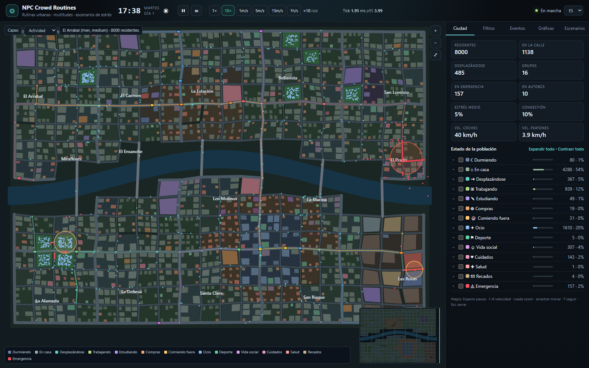

<sub>Ciudad con río (tamaño mediano, 8.000 residentes) un martes a las 17:38: tráfico en vivo, un incendio, un
accidente y un mercadillo en curso, y el árbol de estados de la población a la derecha.</sub>

</div>

---

## Contenido

- [Qué es y para qué sirve](#qué-es-y-para-qué-sirve)
- [Características](#características)
- [Galería](#galería)
- [Inicio rápido](#inicio-rápido)
- [Uso](#uso)
- [Arquitectura](#arquitectura)
- [Modelo de comportamiento](#modelo-de-comportamiento)
- [Reproducibilidad](#reproducibilidad)
- [Rendimiento](#rendimiento)
- [Personalización por datos](#personalización-por-datos)
- [Calidad y pruebas](#calidad-y-pruebas)
- [Consideraciones y limitaciones](#consideraciones-y-limitaciones)
- [Estructura del repositorio](#estructura-del-repositorio)
- [Documentación](#documentación)
- [Hoja de ruta](#hoja-de-ruta)
- [Contribuir](#contribuir)
- [Licencia](#licencia)

---

## Qué es y para qué sirve

NPC Crowd Routines es un **motor de simulación de agentes** que modela la vida diaria de una ciudad y la expone en
una interfaz web en tiempo real. Cada residente toma sus propias decisiones a partir de sus necesidades, su
personalidad, su agenda y lo que percibe a su alrededor. Los patrones de la ciudad (la hora punta, los parques llenos
por la tarde, el atasco tras un accidente, la evacuación ante un incendio) **no están programados**: emergen de esas
decisiones individuales.

Está pensado para:

| Uso | Cómo ayuda |
|---|---|
| **Diseño de NPC para videojuegos** | Prototipar rutinas, subestados y reacciones creíbles de personajes de fondo y ver cómo se comportan en masa. |
| **Pruebas de estrés de multitudes** | Medir el coste por tick con 2.500–60.000 agentes, con informes p50/p95/p99 reproducibles. |
| **Experimentos de comportamiento emergente** | Cambiar un parámetro (caos, plantilla de ciudad, semilla, horarios) y comparar resultados de forma determinista. |
| **Docencia** | Ver en vivo IA por utilidad, A\*, estructuras SoA, simulación de paso fijo y propagación de información. |

> [!NOTE]
> Es un modelo **sintético** pensado para generar comportamiento plausible, no un modelo calibrado con datos reales de
> movilidad. Ver [Consideraciones y limitaciones](#consideraciones-y-limitaciones).

---

## Características

<table>
<tr>
<td width="50%" valign="top">

### Simulación

- **Un único motor C++20** determinista de paso fijo; el navegador solo dibuja y envía órdenes.
- **14 actividades y 85 subestados** jerárquicos: cada residente está siempre en exactamente uno
  (*Desplazándose › Caminando y hablando*, *Trabajando › Pausa para el café*...).
- **IA por utilidad** con 8 necesidades, 12 rasgos de personalidad, **48 arquetipos** (cada residente mezcla dos) y
  **16 perfiles de rutina** con agenda diaria.
- **Grupos reales**: familias y amigos que salen juntos, niños acompañados al colegio, charlas y discusiones en la calle.
- **Transporte**: a pie, bici, coche (congestión y semáforos) y autobús (paradas, aforo, esperas).

</td>
<td width="50%" valign="top">

### Ciudad y eventos

- **6 plantillas procedimentales × 3 tamaños**, barrios con nombre y **36 tipos de edificio** con horarios.
- **Mapas personalizados** en JSON, con validación y errores legibles; se suben desde la interfaz.
- **18 tipos de evento** (tráfico, meteorología, peligros, sociales, públicos), aleatorios con nivel de caos o
  provocados a mano en cualquier punto del mapa.
- **Percepción y propagación**: los residentes se enteran viendo, oyendo, por avisos públicos o porque alguien se lo
  cuenta, y reaccionan según su personalidad.

</td>
</tr>
<tr>
<td valign="top">

### Interfaz

- **Español e inglés**, con cambio en caliente.
- Zoom, minimapa, capas (tráfico, densidad, autobuses, eventos...) y 7 modos de color.
- **Árbol de estados desplegable** y **filtros combinados** (Y/O, negación) evaluados en C++, con exportación a CSV.
- **Inspector**: resumen, agenda, historial, relaciones, acciones y **desglose de la decisión**.
- **Gráficas en el tiempo** de actividades, estrés, necesidades, tráfico y movimiento.

</td>
<td valign="top">

### Experimentación

- **Escenarios** con eventos programados y **partidas guardadas** que se repiten y verifican por *checksum*.
- **Modo sin interfaz** (`run`) que exporta telemetría en CSV y un resumen JSON.
- **Benchmark** integrado con informe en Markdown/JSON.
- **API HTTP** documentada para automatizar experimentos.
- **Todo configurable en `data/`** y documentado en una wiki que genera parte de sus tablas a partir de esos datos.

</td>
</tr>
</table>

---

## Galería

### Seis plantillas de ciudad

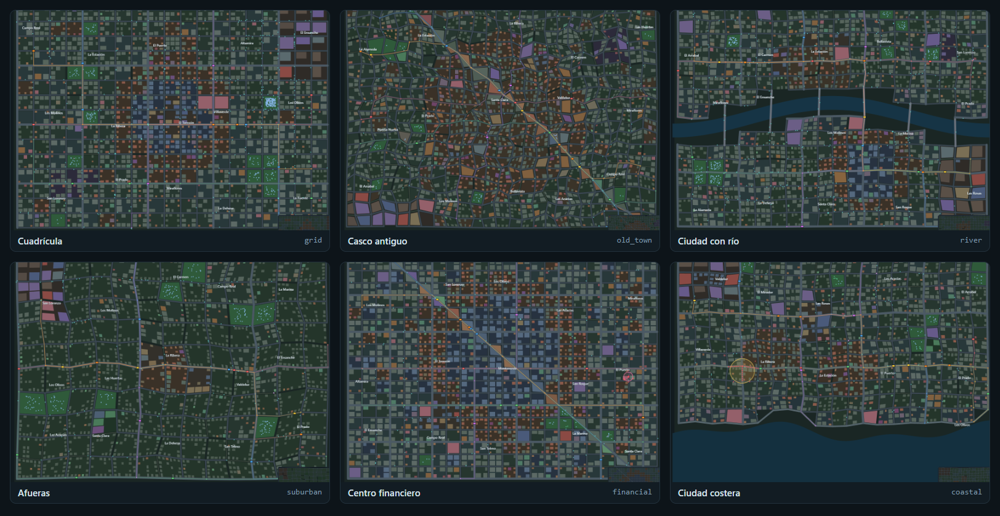

Cada plantilla define la forma de la red de calles, el reparto de barrios (residencial, comercial, oficinas, industria,
ocio...) y los elementos singulares (río con puentes, costa, avenida diagonal). La misma semilla produce siempre la
misma ciudad.

### Estados, inspector y decisiones

<table>
<tr>
<td width="50%">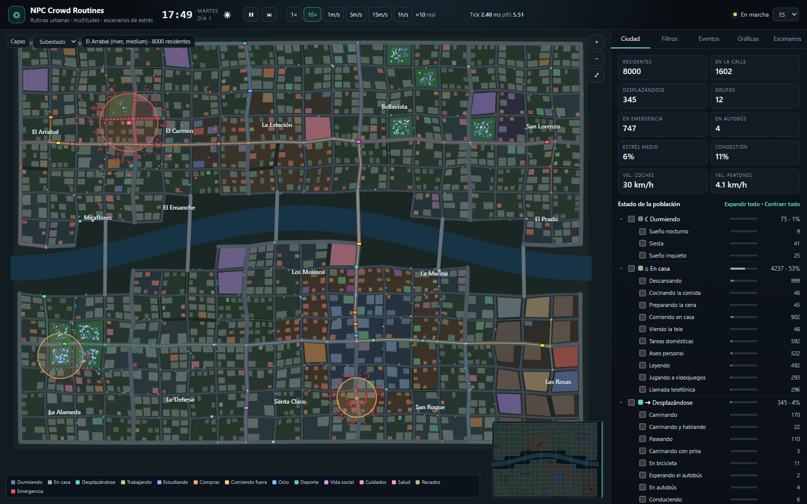</td>
<td width="50%">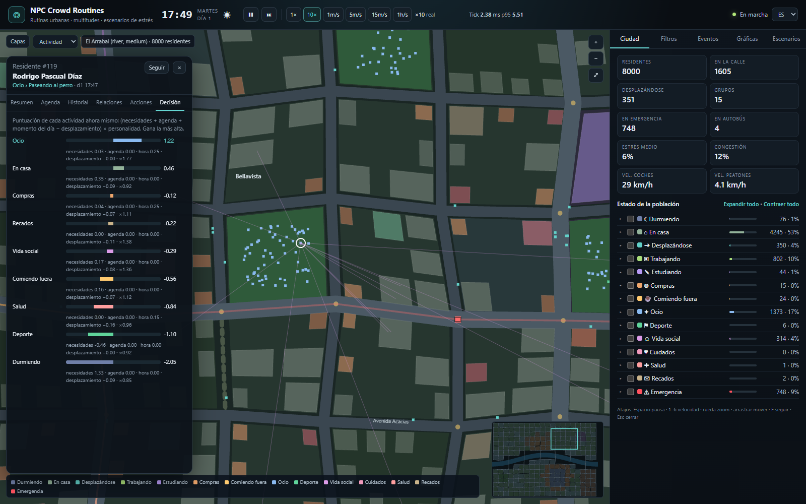</td>
</tr>
<tr>
<td><b>Árbol de estados.</b> Cada actividad se despliega en sus subestados con recuento en vivo; las casillas resaltan a
esos residentes en el mapa.</td>
<td><b>Por qué hace lo que hace.</b> La pestaña <i>Decisión</i> muestra la puntuación de cada actividad y sus términos:
necesidades, agenda, hora, desplazamiento y personalidad.</td>
</tr>
<tr>
<td>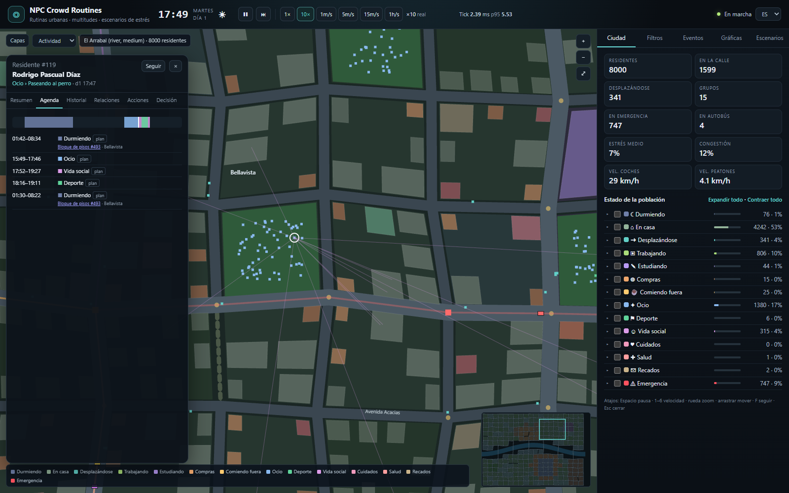</td>
<td>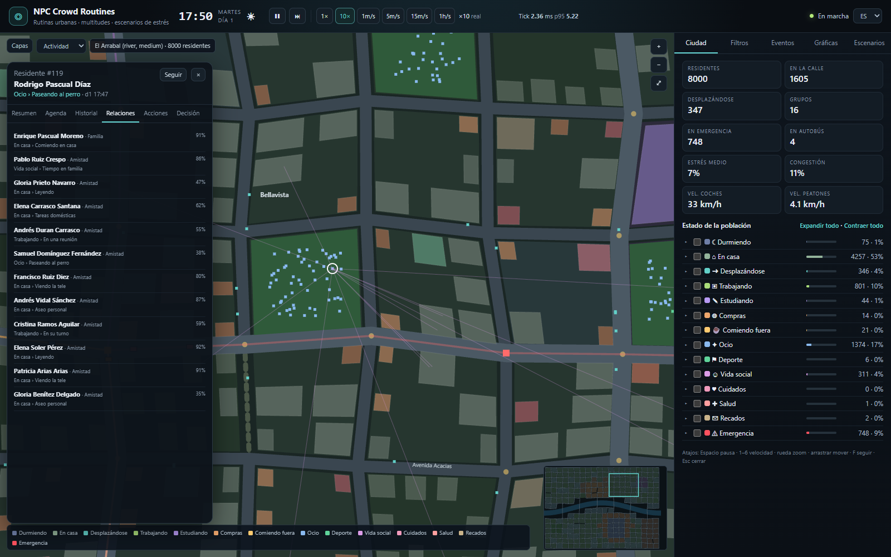</td>
</tr>
<tr>
<td><b>Agenda.</b> Obligaciones y planes del día, con el bloque actual resaltado.</td>
<td><b>Relaciones.</b> Familia, pareja, amistades, compañeros, vecinos y rivales, con su vínculo y lo que hacen ahora.</td>
</tr>
</table>

### Eventos, gráficas y escenarios

<table>
<tr>
<td width="50%">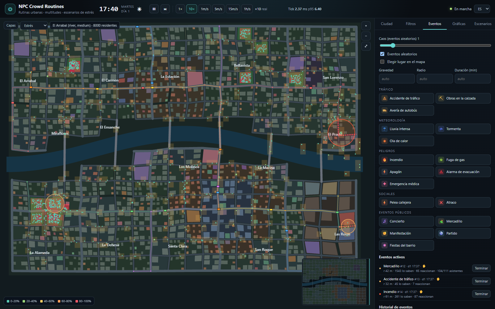</td>
<td width="50%">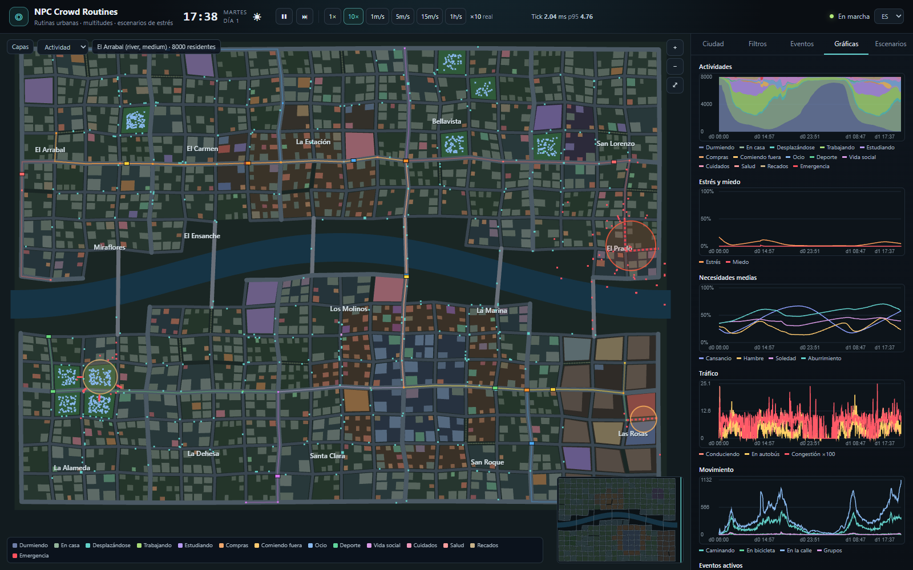</td>
</tr>
<tr>
<td><b>Eventos.</b> Provocar cualquiera de los 18 tipos, regular el caos y seguir cuántos residentes lo saben y
cuántos reaccionan. El mapa está coloreado por estrés.</td>
<td><b>Gráficas.</b> 36 horas simuladas: el ciclo de sueño y trabajo, las horas punta y la respuesta a los eventos.</td>
</tr>
<tr>
<td>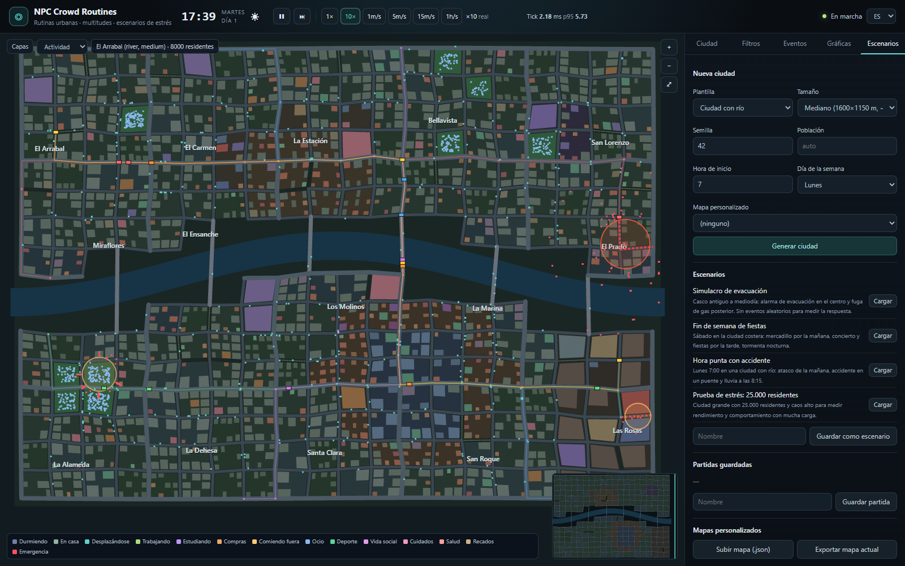</td>
<td>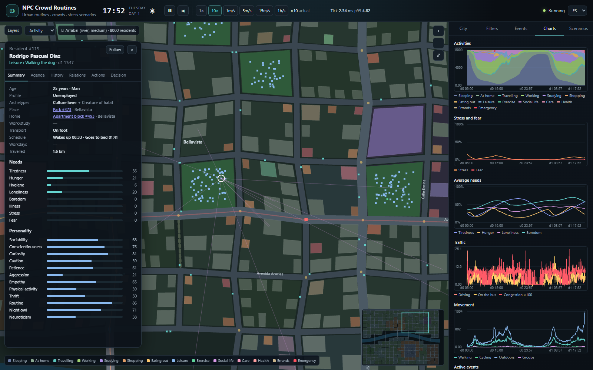</td>
</tr>
<tr>
<td><b>Escenarios.</b> Generar ciudades, cargar o guardar escenarios y partidas, y subir mapas propios.</td>
<td><b>Bilingüe.</b> Toda la interfaz y los nombres del catálogo están traducidos al inglés.</td>
</tr>
</table>

---

## Inicio rápido

### Requisitos

| Herramienta | Versión | Notas |
|---|---|---|
| Compilador C++20 | GCC ≥ 11, Clang ≥ 14 o MSVC (Visual Studio 2022) | probado con GCC 15.2 y MSVC |
| CMake | ≥ 3.25 | usa *presets* de versión 6 |
| Ninja | cualquiera | opcional en Windows/MSVC |
| Navegador | uno actual (probado en Chrome) | solo para la interfaz |

No hay dependencias externas: el JSON, el servidor HTTP y el generador aleatorio están implementados en el propio proyecto.

### Linux o WSL (recomendado)

```sh
sudo apt install build-essential cmake ninja-build git
git clone https://github.com/jossseluuu/NPC-CrowdRoutines.git && cd NPC-CrowdRoutines

cmake --preset wsl-release
cmake --build --preset wsl-release
ctest --preset wsl-release          # opcional: pruebas

./build-wsl/npc_crowd_routines serve --template river --size medium
```

Abre **<http://localhost:8080>** en el navegador (también desde Windows si el servidor corre en WSL).

### Windows

El código compila sin avisos con MSVC (`cmake --preset windows-msvc`). Sin embargo, en equipos con **Smart App
Control** activado Windows bloquea los ejecutables recién compilados que no están firmados. En ese caso se recomienda
compilar y ejecutar en WSL; ver [ADR-0003](docs/decisiones/ADR-0003-wsl-smart-app-control.md).

> [!IMPORTANT]
> Ejecuta los comandos desde la raíz del repositorio: el programa busca por defecto `./data`, `./web` y `./runs`
> (se puede cambiar con `--data`, `--web` y `--runs`).

---

## Uso

```text
npc_crowd_routines <orden> [opciones]
```

| Orden | Para qué |
|---|---|
| `serve` | Simulación con interfaz web en `http://localhost:8080` |
| `run` | Simulación sin interfaz; escribe `telemetry.csv`, `summary.json` y `run.json` |
| `replay <archivo>` | Repite una partida guardada y verifica su *checksum* (código de salida 0 si coincide) |
| `benchmark` | Mide el coste por tick con varias poblaciones y genera un informe |
| `generate-map` | Genera un mapa por plantilla y semilla y lo guarda como JSON editable |
| `validate-map <archivo>` | Valida un mapa personalizado y muestra un resumen |
| `export-docs` | Regenera las tablas de referencia de la wiki a partir de `data/` |

Ejemplos:

```sh
# Ciudad costera grande con 20.000 residentes, empezando un sábado a las 10:00
./build-wsl/npc_crowd_routines serve --template coastal --size large --population 20000 --weekday 5 --start-hour 10

# Cargar un escenario incluido
./build-wsl/npc_crowd_routines serve --scenario data/scenarios/rush_hour.json

# Experimento sin interfaz: 48 horas con caos alto
./build-wsl/npc_crowd_routines run --hours 48 --chaos 3 --seed 7 --out runs/caos3

# Comprobar que una partida guardada se reproduce idéntica
./build-wsl/npc_crowd_routines replay runs/caos3/run.json

# Informe de rendimiento
./build-wsl/npc_crowd_routines benchmark --agents 2500,10000,25000 --markdown informe.md
```

Todas las opciones están en la [referencia de la línea de comandos](docs/referencia/cli.md). La interfaz se explica
en la [guía de la interfaz](docs/guia/interfaz.md), incluidos los atajos de teclado y los enlaces compartibles
(`#select=119&itab=why&zoom=3`).

---

## Arquitectura

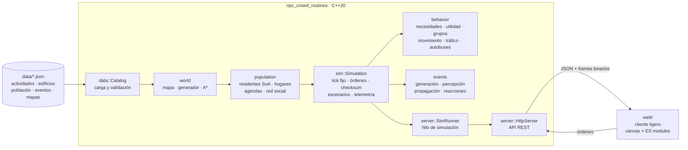

- **Una sola simulación.** Toda la lógica vive en el motor C++; el cliente web (unas 1.600 líneas de JS, CSS y HTML)
  solo dibuja y envía órdenes ([ADR-0002](docs/decisiones/ADR-0002-motor-unico-cpp.md)). En conjunto, **alrededor del
  85 % del código es C++**, sin contar datos JSON ni documentación.
- **Datos orientados a rendimiento.** Los residentes se guardan como *structure of arrays*, las relaciones en formato
  CSR y los historiales en búferes circulares de tamaño fijo ([ADR-0001](docs/decisiones/ADR-0001-storage-backends.md)).
- **Hilos.** La simulación corre en un único hilo por determinismo. `SimRunner` la ejecuta con un presupuesto de tiempo
  por iteración y publica cada 50 ms una instantánea que el servidor entrega sin bloquearla.

Cada tick (1 s simulado por defecto) aplica las órdenes pendientes, avanza el reloj y actualiza, en este orden,
eventos, necesidades, decisiones, movimiento, encuentros y telemetría. Detalles en
[Arquitectura](docs/arquitectura/index.md).

---

## Modelo de comportamiento

Cuando un residente termina lo que hacía, o algo le interrumpe, puntúa cada actividad posible y elige la mejor:

```text
puntuación = base
           + Σ peso(actividad, necesidad) × necesidad^1.5
           + bonificación por hora del día y fin de semana
           + agenda (una obligación activa pesa mucho más que un plan)
           × personalidad (rasgos y preferencias de sus dos arquetipos)
           − mal tiempo si es al aire libre
           − tiempo de desplazamiento × impaciencia
           + inercia + ruido (menor en los residentes rutinarios)
```

Después elige **dónde** (un lugar abierto de la categoría adecuada, según horario, aforo, distancia y sus lugares
favoritos), **cómo llega** (ruta A\* según su medio de transporte) y **con quién** (familiares o amigos libres que se
apunten). Al llegar, elige un subestado coherente con el lugar: *Ocio* en un parque puede ser *Paseando al perro* o
*Relajándose en el parque*.

Los pesos de todas las fórmulas están en `data/`. Explicación completa en
[Comportamiento](docs/conceptos/comportamiento.md) y [Eventos](docs/conceptos/eventos.md).

---

## Reproducibilidad

Con la misma configuración, el mismo binario y las mismas órdenes, una simulación produce **exactamente el mismo
resultado**. Esto se consigue con:

- **Paso fijo**: la velocidad de la interfaz solo cambia cuántos ticks se calculan por segundo real, nunca el resultado.
- **Generador aleatorio propio y portable** (xoshiro256\*\*) con flujos independientes por subsistema (mapa, población,
  comportamiento, eventos, vida social).
- **Órdenes registradas con su número de tick**: al repetir una partida se aplican exactamente en el mismo instante.
- **Checksum del estado**: `replay` vuelve a simular desde cero y compara la huella final.

> [!NOTE]
> La garantía está verificada entre ejecuciones del mismo binario, también en la CI de Linux. Entre compiladores o
> sistemas distintos el resultado puede variar, porque funciones como `std::log` o `std::sqrt` no garantizan el mismo
> último bit en todas las bibliotecas matemáticas. Ver [Reproducibilidad](docs/conceptos/reproducibilidad.md).

---

## Rendimiento

Medido con `npc_crowd_routines benchmark` en una ciudad grande (2.600 × 1.800 m), tras 30 minutos simulados de
calentamiento, sobre 1.800 ticks. Compilación Release (GCC 15.2, `-O3`), **un solo hilo**, AMD Ryzen 7 250 en WSL 2.

| Residentes | p50 | p95 | p99 | Velocidad máxima sostenible | Memoria de residentes |
|---:|---:|---:|---:|---:|---:|
| 2.500 | 0,12 ms | 0,37 ms | 0,79 ms | ×6.100 tiempo real | 5,3 MB |
| 5.000 | 0,25 ms | 0,70 ms | 1,31 ms | ×3.100 | 10,7 MB |
| 10.000 | 0,56 ms | 1,70 ms | 2,38 ms | ×1.400 | 21,5 MB |
| 25.000 | 1,69 ms | 3,61 ms | 4,51 ms | ×520 | 53,9 MB |

Con 25.000 residentes, un día completo se simula en unos 3 minutos, y la interfaz va fluida incluso a 15 minutos
simulados por segundo. El coste crece de forma aproximadamente lineal con la población.

> [!TIP]
> Las cifras dependen del hardware y varían entre ejecuciones (en este portátil, hasta un 15–20 %). Compara siempre en
> la misma máquina. Metodología y último informe en [Rendimiento](docs/rendimiento/index.md).

---

## Personalización por datos

Casi todo el comportamiento se define en JSON dentro de `data/`, sin recompilar:

| Archivo | Define |
|---|---|
| `data/activities.json` | actividades, subestados, pesos de necesidades, horarios preferidos |
| `data/buildings.json` | tipos de edificio, horarios de apertura, aforos, barrios |
| `data/population.json` | perfiles de rutina, arquetipos, rasgos, reparto por edades |
| `data/events.json` | tipos de evento, probabilidad, radio, efectos y reacciones |
| `data/maps/templates.json` | plantillas de ciudad y tamaños |
| `data/maps/custom/*.json` | mapas hechos a mano |
| `data/scenarios/*.json` | escenarios con configuración y eventos programados |
| `data/i18n/{es,en}.json` | textos de la interfaz y nombres del catálogo |

Por ejemplo, un subestado nuevo se añade a su actividad indicando en qué tipos de lugar puede ocurrir y con qué peso,
y se le da nombre en `data/i18n/es.json` y `en.json`:

```json
{ "id": "street_music", "venue": ["park", "plaza"], "weight": 0.4 }
```

El motor valida todos los archivos al arrancar e indica el archivo y el campo de cualquier error. Formatos completos en
[Datos y personalización](docs/datos/index.md), [Mapas personalizados](docs/datos/mapas-personalizados.md) y
[Escenarios](docs/datos/escenarios.md).

---

## Calidad y pruebas

- **27 casos de prueba y más de 2.100 comprobaciones** en `tests/`: JSON y RNG, validación del catálogo, generación de
  mapas y rutas, coherencia de cada residente durante un día completo, determinismo y verificación de partidas,
  eventos y reacciones, contadores de autobuses, grupos, filtros, servidor HTTP y CLI.
- **AddressSanitizer y UndefinedBehaviorSanitizer** sin errores (preset `wsl-debug`).
- **Compilación sin avisos** con GCC (`-Wall -Wextra -Wpedantic`) y MSVC (`/W4`).
- **`text_lint`**, herramienta propia en C++ que impide hacer *commit* de texto corrupto (codificación, BOM, caracteres
  de control, finales de línea) mediante un *hook* de pre-commit.
- **Integración continua** definida con GitHub Actions para Linux y Windows, y publicación automática de la wiki y del
  informe de rendimiento en [GitHub Pages](https://jossseluuu.github.io/NPC-CrowdRoutines/).

```sh
ctest --preset wsl-release                      # todas las pruebas
./build-wsl/engine_tests sim                    # solo las de simulación
cmake --preset wsl-debug && cmake --build --preset wsl-debug && ./build-wsl-debug/engine_tests   # con sanitizers
```

---

## Consideraciones y limitaciones

- **Modelo sintético.** Los horarios, pesos y probabilidades están ajustados para que la ciudad resulte creíble, no
  calibrados con encuestas de movilidad ni datos censales. Sirve para comparar escenarios entre sí, no para predecir
  una ciudad real.
- **Un solo hilo de simulación.** Es una decisión deliberada para garantizar el determinismo. El paralelismo y el nivel
  de detalle variable están en la hoja de ruta.
- **Escala.** El límite configurado es de 60.000 residentes. Con poblaciones muy grandes, el dibujo en el navegador y
  el tamaño de los frames que envía el servidor también influyen en la fluidez de la interfaz, no solo el motor.
- **Movimiento simplificado.** Los peatones siguen la red de aceras sin evitar colisiones individuales, y los coches se
  modelan por ocupación de cada tramo de calle, no como vehículos físicos.
- **Servidor local sin autenticación.** Por defecto escucha solo en `127.0.0.1`. No lo expongas a Internet: con
  `--host 0.0.0.0` cualquiera en la red puede controlar la simulación y subir mapas.
- **Datos ficticios.** Los nombres de residentes, calles y barrios se generan al azar a partir de listas en
  `data/names.json` y `data/maps/names.json`; cualquier parecido con personas reales es casual.
- **Smart App Control en Windows** puede bloquear los ejecutables compilados localmente; ver [Inicio rápido](#windows).

Más detalles en [Consideraciones y limitaciones](docs/consideraciones.md).

---

## Estructura del repositorio

```text
src/core          JSON, generador aleatorio determinista, reloj, geometría
src/data          catálogo: actividades, edificios, población, eventos
src/world         mapa, generador por plantillas, rutas A*
src/population    residentes (SoA), hogares, personalidad, agendas, red social
src/behavior      necesidades, IA por utilidad, grupos, movimiento, tráfico, autobuses
src/events        eventos, percepción, propagación, reacciones
src/sim           bucle de paso fijo, escenarios, partidas, telemetría, consultas
src/server        servidor HTTP y API
src/app           línea de comandos y exportación de documentación
web/              cliente de visualización (HTML, CSS, módulos JS)
data/             catálogo JSON, traducciones, plantillas, mapas y escenarios
tests/            pruebas del motor, servidor y CLI
bench/            micro-benchmark original OOP frente a SoA
tools/            text_lint, hooks de git y utilidades de WSL
docs/             wiki (MkDocs Material), ADR e informes de rendimiento
```

---

## Documentación

La wiki completa está en [`docs/`](docs/index.md) y se publica en [GitHub Pages](https://jossseluuu.github.io/NPC-CrowdRoutines/):

| Sección | Contenido |
|---|---|
| [Primeros pasos](docs/primeros-pasos.md) | Instalación, compilación y primera simulación |
| [Guía de la interfaz](docs/guia/interfaz.md) | Cada panel, pestaña, atajo y enlace compartible |
| Conceptos | [Estados](docs/conceptos/estados.md) · [Comportamiento](docs/conceptos/comportamiento.md) · [Eventos](docs/conceptos/eventos.md) · [Mapas](docs/conceptos/mapas.md) · [Reproducibilidad](docs/conceptos/reproducibilidad.md) |
| Datos | [Formatos](docs/datos/index.md) · [Mapas personalizados](docs/datos/mapas-personalizados.md) · [Escenarios](docs/datos/escenarios.md) |
| Referencia | [CLI](docs/referencia/cli.md) · [API HTTP](docs/referencia/api.md) · tablas generadas desde `data/` |
| Proyecto | [Arquitectura](docs/arquitectura/index.md) · [Rendimiento](docs/rendimiento/index.md) · [Consideraciones](docs/consideraciones.md) · [Preguntas frecuentes](docs/faq.md) · [Glosario](docs/glosario.md) |
| Desarrollo | [Control de versiones](docs/desarrollo/control-de-versiones.md) · [Pruebas e integración continua](docs/desarrollo/pruebas.md) · [Decisiones (ADR)](docs/decisiones/ADR-0001-storage-backends.md) |

Para ver la wiki en local: `pip install mkdocs-material && python -m mkdocs serve`.

---

## Hoja de ruta

- [x] Motor único en C++ con interfaz web ligera
- [x] Estados jerárquicos, IA por utilidad, grupos y encuentros
- [x] Mapas procedimentales, mapas personalizados, autobuses, semáforos y congestión
- [x] Eventos con percepción, propagación y reacciones
- [x] Escenarios, partidas reproducibles, telemetría y benchmark
- [x] Interfaz bilingüe y wiki con referencias generadas
- [ ] Simulación en paralelo y nivel de detalle variable para más de 60.000 residentes
- [ ] Editor de mapas en el navegador
- [ ] Demo en WebAssembly publicable en GitHub Pages

Los cambios de cada versión están en el [CHANGELOG](CHANGELOG.md).

---

## Contribuir

1. Activa el *hook* de pre-commit: `git config core.hooksPath tools/hooks`.
2. Crea una rama por funcionalidad (`feat/...`, `fix/...`, `docs/...`).
3. Usa *commits* convencionales con el módulo como ámbito: `fix(behavior): ...`, `feat(web): ...`, `docs: ...`.
4. Comprueba que `ctest --preset wsl-release` pasa y, si tocas `data/`, regenera la referencia con `export-docs`.

Normas completas en [Control de versiones](docs/desarrollo/control-de-versiones.md).

---

## Licencia

© 2026 Jose Luis. Distribuido bajo la **[PolyForm Noncommercial License 1.0.0](LICENSE)**.

| Puedes | No puedes sin permiso |
|---|---|
| Ver, compilar, ejecutar y modificar el código | Usarlo con fines comerciales (productos, servicios de pago, uso interno en una empresa con ánimo de lucro) |
| Usarlo para estudiar, investigar, enseñar o en proyectos personales | Eliminar el aviso de copyright (`Required Notice`) |
| Redistribuirlo, con o sin cambios, sin ánimo de lucro, incluyendo la licencia y el aviso | |

Las organizaciones benéficas, educativas, de investigación pública y gubernamentales también pueden usarlo. Para
cualquier uso comercial, [abre un *issue*](https://github.com/jossseluuu/NPC-CrowdRoutines/issues) o contacta con el
autor para obtener una licencia comercial.

> [!NOTE]
> El texto legal de la licencia está en inglés y es el único vinculante; esta tabla es un resumen orientativo.
