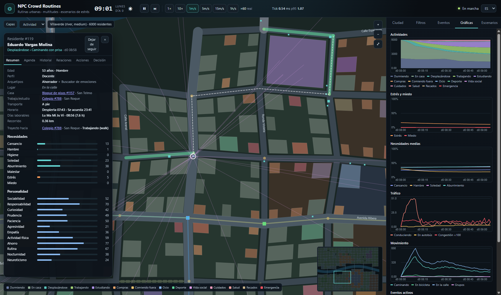

# NPC Crowd Routines

Simulador de una ciudad viva escrito en **C++20**: miles de residentes con rutinas, personalidad y relaciones que
trabajan, estudian, compran, quedan, se desplazan a pie, en bici, en coche o en autobús, y reaccionan a eventos.
Banco de pruebas de comportamiento emergente y de rendimiento (25.000 residentes a ~1,2 ms por tick).



## Características

- **Un único motor C++ determinista** con servidor HTTP propio; el navegador solo dibuja (cliente fino).
- **14 actividades y 85 subestados** (*Desplazándose › Caminando y hablando*, *Trabajando › Pausa para el café*...).
- **IA por utilidad**: 8 necesidades, 12 rasgos, **48 arquetipos** combinables, 16 perfiles de rutina, agendas diarias,
  grupos que salen juntos, conversaciones y discusiones en la calle.
- **Mapas**: 6 plantillas procedimentales × 3 tamaños, barrios con nombre, 36 tipos de edificio con horarios, autobuses,
  semáforos y congestión; **mapas personalizados** en JSON.
- **18 eventos** aleatorios o manuales con percepción, avisos, boca a boca y reacciones según la personalidad.
- **Escenarios reproducibles** y partidas guardadas con verificación por *checksum*.
- **Interfaz en español e inglés**: zoom, capas, árbol de estados desplegable, filtros combinados, inspector (agenda,
  historial, relaciones, acciones, desglose de la decisión), gráficas en el tiempo.
- Todo configurable en `data/` (JSON validado) y documentado en una wiki generada en parte desde esos datos.

## Inicio rápido (WSL / Linux)

```sh
sudo apt install build-essential cmake ninja-build git
cmake --preset wsl-release && cmake --build --preset wsl-release
ctest --preset wsl-release
./build-wsl/npc_crowd_routines serve --template river --size medium
```

Abre **http://localhost:8080**. En Windows se recomienda WSL porque *Smart App Control* puede bloquear los `.exe` recién
compilados (ver [ADR-0003](docs/decisiones/ADR-0003-wsl-smart-app-control.md)).

Otras órdenes: `run` (sin interfaz, CSV), `replay` (verificar una partida), `benchmark`, `generate-map`,
`validate-map`, `export-docs`. Detalles en [docs/referencia/cli.md](docs/referencia/cli.md).

## Documentación

La wiki está en [`docs/`](docs/index.md) y se publica con GitHub Pages:

- [Primeros pasos](docs/primeros-pasos.md) · [Guía de la interfaz](docs/guia/interfaz.md)
- Conceptos: [estados](docs/conceptos/estados.md), [comportamiento](docs/conceptos/comportamiento.md),
  [eventos](docs/conceptos/eventos.md), [mapas](docs/conceptos/mapas.md), [reproducibilidad](docs/conceptos/reproducibilidad.md)
- [Formatos de datos](docs/datos/index.md) · [Mapas personalizados](docs/datos/mapas-personalizados.md) ·
  [Escenarios](docs/datos/escenarios.md)
- [API HTTP](docs/referencia/api.md) · [Arquitectura](docs/arquitectura/index.md) · [Rendimiento](docs/rendimiento/index.md)
- [Control de versiones](docs/desarrollo/control-de-versiones.md) · [Pruebas e integración continua](docs/desarrollo/pruebas.md)

## Estructura

```
src/core        JSON, RNG determinista, reloj, geometría
src/data        catálogo (actividades, edificios, población, eventos)
src/world       mapa, generador por plantillas, rutas
src/population  residentes (SoA), hogares, personalidad, horarios, red social
src/behavior    necesidades, IA por utilidad, grupos, movimiento, tráfico, autobuses
src/events      eventos, percepción, reacciones
src/sim         bucle de paso fijo, escenarios, partidas, telemetría, consultas
src/server      servidor HTTP y API      src/app  línea de comandos
web/            cliente de visualización
data/           datos JSON, traducciones, plantillas, mapas y escenarios
tests/          pruebas      bench/  micro-benchmark OOP/SoA      tools/  text_lint y hooks
docs/           wiki (MkDocs)
```

## Contribuir

Commits convencionales con ámbito de módulo, ramas por funcionalidad y `text_lint` en pre-commit
(`git config core.hooksPath tools/hooks`). Ver [docs/desarrollo/control-de-versiones.md](docs/desarrollo/control-de-versiones.md)
y el [CHANGELOG](CHANGELOG.md).
