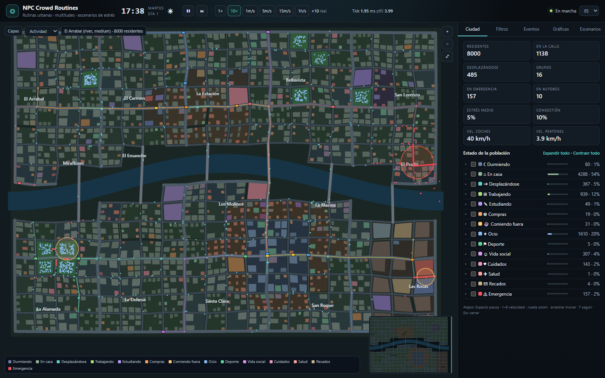
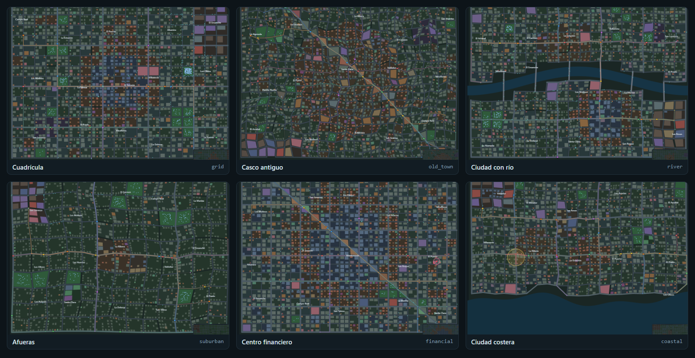
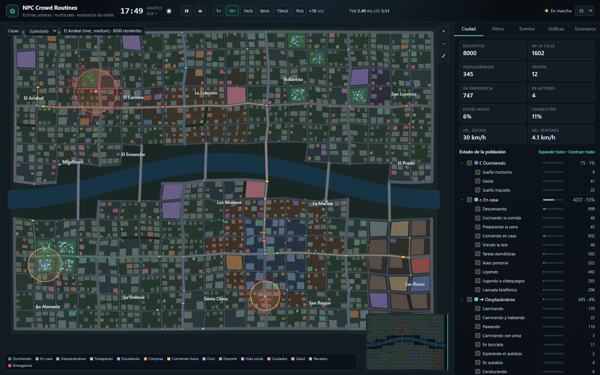
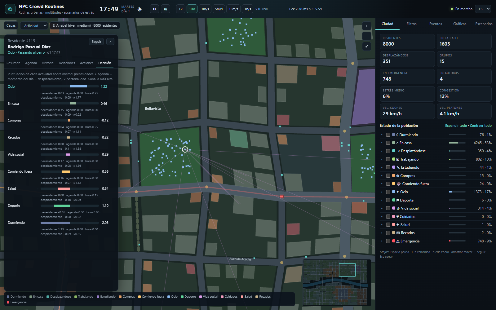
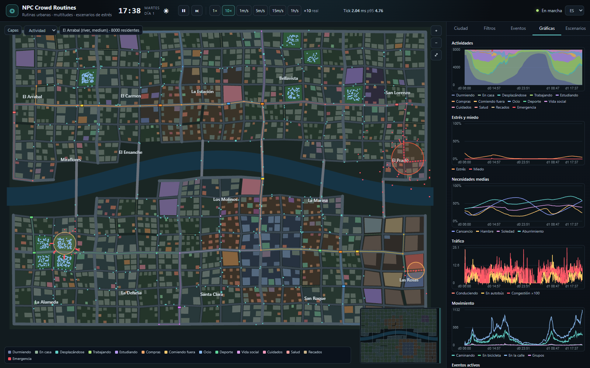
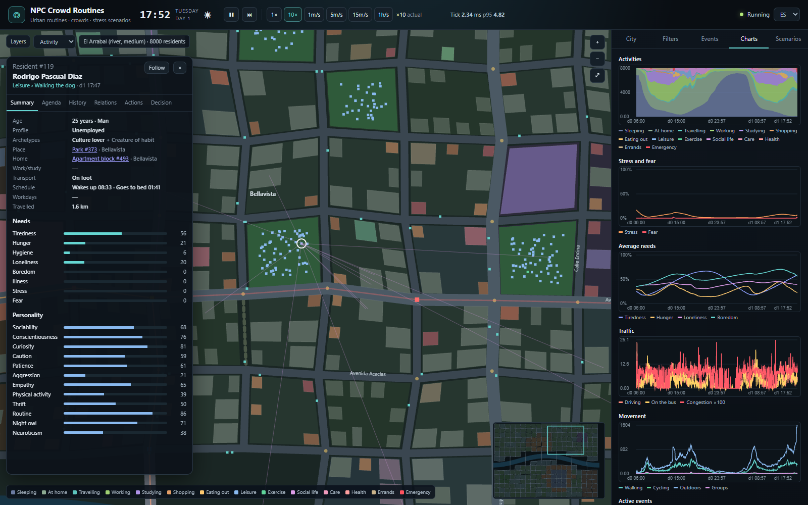
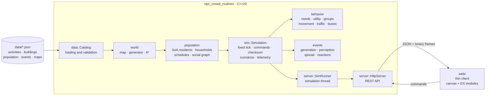

<div align="center">

**English** · [Español](README.es.md)

# NPC Crowd Routines

**An urban NPC routine simulator and crowd test bench, written in C++20.**

Thousands of residents with personality, schedules and relationships live a full day in a procedurally generated
city: they work, study, shop, meet friends, get around on foot, by bike, car or bus, and react to fires, storms,
accidents or concerts.


-555)


[](https://github.com/jossseluuu/NPC-CrowdRoutines/actions/workflows/ci.yml)



<sub>River city (medium size, 8,000 residents) on a Tuesday at 17:38: live traffic, a fire, an accident and a street
market in progress, with the population state tree on the right.</sub>

</div>

---

## Contents

- [What it is and what it is for](#what-it-is-and-what-it-is-for)
- [Features](#features)
- [Gallery](#gallery)
- [Quick start](#quick-start)
- [Usage](#usage)
- [Architecture](#architecture)
- [Behaviour model](#behaviour-model)
- [Reproducibility](#reproducibility)
- [Performance](#performance)
- [Data-driven customisation](#data-driven-customisation)
- [Quality and testing](#quality-and-testing)
- [Considerations and limitations](#considerations-and-limitations)
- [Repository layout](#repository-layout)
- [Documentation](#documentation)
- [Roadmap](#roadmap)
- [Contributing](#contributing)
- [License](#license)

---

## What it is and what it is for

NPC Crowd Routines is an **agent-based simulation engine** that models the daily life of a city and exposes it
through a real-time web interface. Each resident makes their own decisions based on their needs, personality,
schedule and what they perceive around them. City-wide patterns (rush hour, parks filling up in the afternoon, the
jam after an accident, the evacuation during a fire) **are not scripted**: they emerge from those individual
decisions.

It is designed for:

| Use | How it helps |
|---|---|
| **NPC design for video games** | Prototype believable routines, sub-states and reactions for background characters and see how they behave en masse. |
| **Crowd stress testing** | Measure per-tick cost with 2,500–60,000 agents, with reproducible p50/p95/p99 reports. |
| **Emergent behaviour experiments** | Change one parameter (chaos, city template, seed, schedules) and compare results deterministically. |
| **Teaching** | Watch utility AI, A\*, SoA data layouts, fixed-step simulation and information spread live. |

> [!NOTE]
> This is a **synthetic** model built to produce plausible behaviour, not a model calibrated against real mobility
> data. See [Considerations and limitations](#considerations-and-limitations).

---

## Features

<table>
<tr>
<td width="50%" valign="top">

### Simulation

- **A single deterministic, fixed-step C++20 engine**; the browser only draws and sends commands.
- **14 activities and 85 hierarchical sub-states**: every resident is always in exactly one
  (*Commuting › Walking and talking*, *Working › Coffee break*...).
- **Utility AI** with 8 needs, 12 personality traits, **48 archetypes** (each resident blends two) and
  **16 routine profiles** with a daily schedule.
- **Real groups**: families and friends going out together, children walked to school, chats and arguments in the street.
- **Transport**: walking, cycling, cars (congestion and traffic lights) and buses (stops, capacity, waiting).

</td>
<td width="50%" valign="top">

### City and events

- **6 procedural templates × 3 sizes**, named neighbourhoods and **36 building types** with opening hours.
- **Custom maps** in JSON, with validation and readable errors; upload them from the UI.
- **18 event types** (traffic, weather, hazards, social, public), random according to a chaos level or triggered by
  hand anywhere on the map.
- **Perception and spread**: residents find out by seeing, hearing, through public alerts or because someone tells
  them, and react according to their personality.

</td>
</tr>
<tr>
<td valign="top">

### Interface

- **English and Spanish**, switchable on the fly.
- Zoom, minimap, layers (traffic, density, buses, events...) and 7 colour modes.
- **Collapsible state tree** and **combined filters** (AND/OR, negation) evaluated in C++, with CSV export.
- **Inspector**: summary, schedule, history, relationships, actions and a **decision breakdown**.
- **Time-series charts** of activities, stress, needs, traffic and movement.

</td>
<td valign="top">

### Experimentation

- **Scenarios** with scheduled events and **saved runs** that replay and verify by *checksum*.
- **Headless mode** (`run`) that exports CSV telemetry and a JSON summary.
- Built-in **benchmark** with a Markdown/JSON report.
- Documented **HTTP API** to automate experiments.
- **Everything configurable in `data/`** and documented in a wiki that generates some of its tables from that data.

</td>
</tr>
</table>

---

## Gallery

### Six city templates



Each template defines the shape of the street network, the mix of districts (residential, commercial, offices,
industry, leisure...) and landmark features (a river with bridges, a coastline, a diagonal avenue). The same seed
always produces the same city.

### States, inspector and decisions

<table>
<tr>
<td width="50%"></td>
<td width="50%"></td>
</tr>
<tr>
<td><b>State tree.</b> Each activity expands into its sub-states with live counts; the checkboxes highlight those
residents on the map.</td>
<td><b>Why they do what they do.</b> The <i>Decision</i> tab shows each activity's score and its terms: needs,
schedule, time of day, travel and personality.</td>
</tr>
<tr>
<td></td>
<td></td>
</tr>
<tr>
<td><b>Schedule.</b> The day's obligations and plans, with the current block highlighted.</td>
<td><b>Relationships.</b> Family, partner, friends, colleagues, neighbours and rivals, with their bond and what they
are doing right now.</td>
</tr>
</table>

### Events, charts and scenarios

<table>
<tr>
<td width="50%"></td>
<td width="50%"></td>
</tr>
<tr>
<td><b>Events.</b> Trigger any of the 18 types, tune the chaos level and track how many residents know about it and
how many react. The map is coloured by stress.</td>
<td><b>Charts.</b> 36 simulated hours: the sleep and work cycle, rush hours and the response to events.</td>
</tr>
<tr>
<td></td>
<td></td>
</tr>
<tr>
<td><b>Scenarios.</b> Generate cities, load or save scenarios and runs, and upload your own maps.</td>
<td><b>Bilingual.</b> The whole interface and every catalogue name is available in English and Spanish.</td>
</tr>
</table>

---

## Quick start

### Requirements

| Tool | Version | Notes |
|---|---|---|
| C++20 compiler | GCC ≥ 11, Clang ≥ 14 or MSVC (Visual Studio 2022) | tested with GCC 15.2 and MSVC |
| CMake | ≥ 3.25 | uses version 6 *presets* |
| Ninja | any | optional on Windows/MSVC |
| Browser | any recent one (tested on Chrome) | only for the UI |

There are no external dependencies: JSON, the HTTP server and the random generator are all implemented in the project.

### Linux or WSL (recommended)

```sh
sudo apt install build-essential cmake ninja-build git
git clone https://github.com/jossseluuu/NPC-CrowdRoutines.git && cd NPC-CrowdRoutines

cmake --preset wsl-release
cmake --build --preset wsl-release
ctest --preset wsl-release          # optional: tests

./build-wsl/npc_crowd_routines serve --template river --size medium
```

Open **<http://localhost:8080>** in your browser (also from Windows if the server runs in WSL).

### Windows

The code compiles warning-free with MSVC (`cmake --preset windows-msvc`). However, on machines with **Smart App
Control** enabled, Windows blocks freshly compiled unsigned executables. In that case, building and running in WSL is
recommended; see [ADR-0003](docs/decisiones/ADR-0003-wsl-smart-app-control.md).

> [!IMPORTANT]
> Run commands from the repository root: by default the program looks for `./data`, `./web` and `./runs`
> (override with `--data`, `--web` and `--runs`).

---

## Usage

```text
npc_crowd_routines <command> [options]
```

| Command | Purpose |
|---|---|
| `serve` | Simulation with the web UI at `http://localhost:8080` |
| `run` | Headless simulation; writes `telemetry.csv`, `summary.json` and `run.json` |
| `replay <file>` | Replays a saved run and verifies its *checksum* (exit code 0 if it matches) |
| `benchmark` | Measures per-tick cost for several population sizes and writes a report |
| `generate-map` | Generates a map from a template and seed and saves it as editable JSON |
| `validate-map <file>` | Validates a custom map and prints a summary |
| `export-docs` | Regenerates the wiki reference tables from `data/` |

Examples:

```sh
# Large coastal city with 20,000 residents, starting on a Saturday at 10:00
./build-wsl/npc_crowd_routines serve --template coastal --size large --population 20000 --weekday 5 --start-hour 10

# Load a bundled scenario
./build-wsl/npc_crowd_routines serve --scenario data/scenarios/rush_hour.json

# Headless experiment: 48 hours with high chaos
./build-wsl/npc_crowd_routines run --hours 48 --chaos 3 --seed 7 --out runs/chaos3

# Check that a saved run replays identically
./build-wsl/npc_crowd_routines replay runs/chaos3/run.json

# Performance report
./build-wsl/npc_crowd_routines benchmark --agents 2500,10000,25000 --markdown report.md
```

Every option is listed in the [command-line reference](docs/referencia/cli.md). The UI is explained in the
[interface guide](docs/guia/interfaz.md), including keyboard shortcuts and shareable links
(`#select=119&itab=why&zoom=3`).

---

## Architecture



- **One simulation.** All logic lives in the C++ engine; the web client (about 1,600 lines of JS, CSS and HTML) only
  draws and sends commands ([ADR-0002](docs/decisiones/ADR-0002-motor-unico-cpp.md)). Overall, **around 85 % of the
  code is C++**, not counting JSON data or documentation.
- **Performance-oriented data.** Residents are stored as a *structure of arrays*, relationships in CSR format and
  histories in fixed-size ring buffers ([ADR-0001](docs/decisiones/ADR-0001-storage-backends.md)).
- **Threads.** The simulation runs on a single thread for determinism. `SimRunner` drives it with a time budget per
  iteration and publishes a snapshot every 50 ms that the server serves without blocking it.

Each tick (1 simulated second by default) applies pending commands, advances the clock and updates, in this order,
events, needs, decisions, movement, encounters and telemetry. Details in [Architecture](docs/arquitectura/index.md).

---

## Behaviour model

When a resident finishes what they were doing, or something interrupts them, they score every possible activity and
pick the best one:

```text
score = base
      + Σ weight(activity, need) × need^1.5
      + time-of-day and weekend bonus
      + schedule (an active obligation weighs far more than a plan)
      × personality (traits and preferences of their two archetypes)
      − bad weather if outdoors
      − travel time × impatience
      + inertia + noise (lower for routine-driven residents)
```

Then they choose **where** (an open venue of the right category, based on opening hours, capacity, distance and
their favourite places), **how to get there** (an A\* route for their mode of transport) and **with whom** (free
family members or friends who want to join). On arrival they pick a sub-state that fits the venue: *Leisure* in a park
can be *Walking the dog* or *Relaxing in the park*.

All formula weights live in `data/`. Full explanation in [Behaviour](docs/conceptos/comportamiento.md) and
[Events](docs/conceptos/eventos.md).

---

## Reproducibility

With the same configuration, the same binary and the same commands, a simulation produces **exactly the same
result**. This is achieved with:

- **Fixed step**: the UI speed only changes how many ticks are computed per real second, never the outcome.
- **A custom, portable random generator** (xoshiro256\*\*) with independent streams per subsystem (map, population,
  behaviour, events, social life).
- **Commands recorded with their tick number**: when a run is replayed they are applied at exactly the same instant.
- **State checksum**: `replay` re-simulates from scratch and compares the final fingerprint.

> [!NOTE]
> The guarantee is verified across runs of the same binary, including in Linux CI. Across different compilers or
> systems the result may differ, because functions such as `std::log` or `std::sqrt` do not guarantee the same last
> bit in every maths library. See [Reproducibility](docs/conceptos/reproducibilidad.md).

---

## Performance

Measured with `npc_crowd_routines benchmark` in a large city (2,600 × 1,800 m), after a 30 simulated-minute warm-up,
over 1,800 ticks. Release build (GCC 15.2, `-O3`), **single thread**, AMD Ryzen 7 250 on WSL 2.

| Residents | p50 | p95 | p99 | Max sustainable speed | Resident memory |
|---:|---:|---:|---:|---:|---:|
| 2,500 | 0.12 ms | 0.37 ms | 0.79 ms | ×6,100 real time | 5.3 MB |
| 5,000 | 0.25 ms | 0.70 ms | 1.31 ms | ×3,100 | 10.7 MB |
| 10,000 | 0.56 ms | 1.70 ms | 2.38 ms | ×1,400 | 21.5 MB |
| 25,000 | 1.69 ms | 3.61 ms | 4.51 ms | ×520 | 53.9 MB |

With 25,000 residents a full day is simulated in about 3 minutes, and the UI stays smooth even at 15 simulated
minutes per second. Cost grows roughly linearly with population.

> [!TIP]
> Figures depend on hardware and vary between runs (on this laptop, by up to 15–20 %). Always compare on the same
> machine. Methodology and the latest report in [Performance](docs/rendimiento/index.md).

---

## Data-driven customisation

Almost all behaviour is defined in JSON inside `data/`, with no recompilation:

| File | Defines |
|---|---|
| `data/activities.json` | activities, sub-states, need weights, preferred hours |
| `data/buildings.json` | building types, opening hours, capacities, districts |
| `data/population.json` | routine profiles, archetypes, traits, age distribution |
| `data/events.json` | event types, probability, radius, effects and reactions |
| `data/maps/templates.json` | city templates and sizes |
| `data/maps/custom/*.json` | hand-made maps |
| `data/scenarios/*.json` | scenarios with configuration and scheduled events |
| `data/i18n/{es,en}.json` | UI strings and catalogue names |

For example, a new sub-state is added to its activity by stating which venue types it can happen in and with what
weight, and given a name in `data/i18n/es.json` and `en.json`:

```json
{ "id": "street_music", "venue": ["park", "plaza"], "weight": 0.4 }
```

The engine validates every file on start-up and reports the file and field of any error. Full formats in
[Data and customisation](docs/datos/index.md), [Custom maps](docs/datos/mapas-personalizados.md) and
[Scenarios](docs/datos/escenarios.md).

---

## Quality and testing

- **27 test cases and over 2,100 assertions** in `tests/`: JSON and RNG, catalogue validation, map and route
  generation, per-resident consistency over a full day, determinism and run verification, events and reactions, bus
  counters, groups, filters, HTTP server and CLI.
- **AddressSanitizer and UndefinedBehaviorSanitizer** clean (`wsl-debug` preset).
- **Warning-free builds** with GCC (`-Wall -Wextra -Wpedantic`) and MSVC (`/W4`).
- **`text_lint`**, an in-house C++ tool that blocks commits of corrupted text (encoding, BOM, control characters,
  line endings) via a pre-commit *hook*.
- **Continuous integration** with GitHub Actions on Linux and Windows, and automatic publishing of the wiki and the
  performance report to [GitHub Pages](https://jossseluuu.github.io/NPC-CrowdRoutines/).

```sh
ctest --preset wsl-release                      # all tests
./build-wsl/engine_tests sim                    # simulation tests only
cmake --preset wsl-debug && cmake --build --preset wsl-debug && ./build-wsl-debug/engine_tests   # with sanitizers
```

---

## Considerations and limitations

- **Synthetic model.** Schedules, weights and probabilities are tuned so the city feels believable, not calibrated
  against mobility surveys or census data. It is meant for comparing scenarios with each other, not for predicting a
  real city.
- **Single simulation thread.** A deliberate choice to guarantee determinism. Parallelism and variable level of
  detail are on the roadmap.
- **Scale.** The configured limit is 60,000 residents. With very large populations, browser rendering and the size
  of the frames the server sends also affect UI smoothness, not just the engine.
- **Simplified movement.** Pedestrians follow the sidewalk network without individual collision avoidance, and cars
  are modelled by occupancy of each street segment, not as physical vehicles.
- **Local server without authentication.** By default it listens only on `127.0.0.1`. Do not expose it to the
  Internet: with `--host 0.0.0.0` anyone on the network can control the simulation and upload maps.
- **Fictional data.** Resident, street and district names are generated at random from lists in `data/names.json`
  and `data/maps/names.json`; any resemblance to real people is coincidental.
- **Smart App Control on Windows** may block locally compiled executables; see [Quick start](#windows).

More details in [Considerations and limitations](docs/consideraciones.md).

---

## Repository layout

```text
src/core          JSON, deterministic random generator, clock, geometry
src/data          catalogue: activities, buildings, population, events
src/world         map, template generator, A* routing
src/population    residents (SoA), households, personality, schedules, social graph
src/behavior      needs, utility AI, groups, movement, traffic, buses
src/events        events, perception, spread, reactions
src/sim           fixed-step loop, scenarios, saved runs, telemetry, queries
src/server        HTTP server and API
src/app           command line and documentation export
web/              visualisation client (HTML, CSS, JS modules)
data/             JSON catalogue, translations, templates, maps and scenarios
tests/            engine, server and CLI tests
bench/            original OOP vs SoA micro-benchmark
tools/            text_lint, git hooks and WSL utilities
docs/             wiki (MkDocs Material), ADRs and performance reports
```

---

## Documentation

The full wiki lives in [`docs/`](docs/index.md) and is published on
[GitHub Pages](https://jossseluuu.github.io/NPC-CrowdRoutines/). It is currently **written in Spanish**; an English
version is planned.

| Section | Contents |
|---|---|
| [Getting started](docs/primeros-pasos.md) | Installation, building and your first simulation |
| [Interface guide](docs/guia/interfaz.md) | Every panel, tab, shortcut and shareable link |
| Concepts | [States](docs/conceptos/estados.md) · [Behaviour](docs/conceptos/comportamiento.md) · [Events](docs/conceptos/eventos.md) · [Maps](docs/conceptos/mapas.md) · [Reproducibility](docs/conceptos/reproducibilidad.md) |
| Data | [Formats](docs/datos/index.md) · [Custom maps](docs/datos/mapas-personalizados.md) · [Scenarios](docs/datos/escenarios.md) |
| Reference | [CLI](docs/referencia/cli.md) · [HTTP API](docs/referencia/api.md) · tables generated from `data/` |
| Project | [Architecture](docs/arquitectura/index.md) · [Performance](docs/rendimiento/index.md) · [Considerations](docs/consideraciones.md) · [FAQ](docs/faq.md) · [Glossary](docs/glosario.md) |
| Development | [Version control](docs/desarrollo/control-de-versiones.md) · [Testing and CI](docs/desarrollo/pruebas.md) · [Decisions (ADRs)](docs/decisiones/ADR-0001-storage-backends.md) |

To browse the wiki locally: `pip install mkdocs-material && python -m mkdocs serve`.

---

## Roadmap

- [x] Single C++ engine with a thin web UI
- [x] Hierarchical states, utility AI, groups and encounters
- [x] Procedural maps, custom maps, buses, traffic lights and congestion
- [x] Events with perception, spread and reactions
- [x] Scenarios, reproducible runs, telemetry and benchmark
- [x] Bilingual UI and wiki with generated references
- [ ] Parallel simulation and variable level of detail for more than 60,000 residents
- [ ] In-browser map editor
- [ ] WebAssembly demo publishable on GitHub Pages
- [ ] English version of the wiki

Changes in each version are listed in the [CHANGELOG](CHANGELOG.md).

---

## Contributing

1. Enable the pre-commit *hook*: `git config core.hooksPath tools/hooks`.
2. Create one branch per feature (`feat/...`, `fix/...`, `docs/...`).
3. Use conventional commits with the module as scope: `fix(behavior): ...`, `feat(web): ...`, `docs: ...`.
4. Make sure `ctest --preset wsl-release` passes and, if you touch `data/`, regenerate the reference with `export-docs`.

Full guidelines in [Version control](docs/desarrollo/control-de-versiones.md).

---

## License

© 2026 Jose Luis. Released under the **[PolyForm Noncommercial License 1.0.0](LICENSE)**.

| You may | You may not, without permission |
|---|---|
| View, build, run and modify the code | Use it for commercial purposes (products, paid services, internal use at a for-profit company) |
| Use it for study, research, teaching or personal projects | Remove the copyright notice (`Required Notice`) |
| Redistribute it, with or without changes, for non-commercial purposes, including the license and notice | |

Charitable, educational, public research and government organisations may also use it. For any commercial use,
[open an issue](https://github.com/jossseluuu/NPC-CrowdRoutines/issues) or contact the author to obtain a commercial
license.

> [!NOTE]
> The [LICENSE](LICENSE) file is the only legally binding text; this table is an informal summary.
