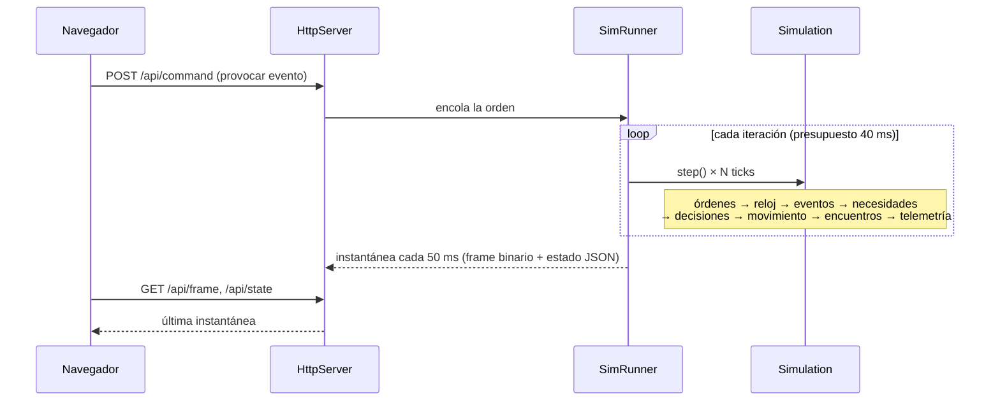

# Visión general de la arquitectura

```text
                 ┌──────────────────────── npc_crowd_routines (C++20) ────────────────────────┐
 data/*.json ──► │ data::Catalog ──► world (mapa, generador, rutas) ──► population (residentes)│
                 │        │                                                     │             │
                 │        ▼                                                     ▼             │
                 │   sim::Simulation  ── tick fijo ──►  events · behavior · movement           │
                 │        │   órdenes con tick, escenarios, partidas, checksum, telemetría      │
                 │        ▼                                                                    │
                 │   server::SimRunner (hilo de simulación) ──► server::HttpServer + API        │
                 └────────────────────────────────────────────┬───────────────────────────────┘
                                                              │ JSON + frames binarios
                                                    web/ (dibuja y envía órdenes, ~15 % del código)
```

Solo existe **una simulación**, la del motor C++ ([ADR-0002](../decisiones/ADR-0002-motor-unico-cpp.md)).

## Módulos

| Módulo | Carpeta | Responsabilidad |
|---|---|---|
| `core` | `src/core/` | JSON sin dependencias, RNG determinista portable, reloj, geometría |
| `data` | `src/data/` | carga y validación del catálogo |
| `world` | `src/world/` | `CityMap`, formato de mapas, generador por plantillas, A* con cortes y caché de rutas |
| `population` | `src/population/` | almacenamiento SoA de residentes, generación de hogares, personalidad, horarios, empleo, red social, agendas |
| `behavior` | `src/behavior/` | necesidades, IA por utilidad, elección de lugar y subestado, grupos, encuentros; movimiento, tráfico, semáforos y autobuses |
| `events` | `src/events/` | generación, ciclo de vida, efectos, percepción, propagación y reacciones |
| `sim` | `src/sim/` | estado compartido, bucle de paso fijo, órdenes, escenarios, partidas, *checksum*, telemetría, consultas |
| `server` | `src/server/` | servidor HTTP propio, ejecutor en segundo plano y API |
| `app` | `src/app/` | línea de comandos y exportación de documentación |
| `web` | `web/` | cliente de visualización |

## El tick



En cada tick (1 s simulado por defecto), `Simulation::step()`:

1. aplica las órdenes programadas o recibidas para este tick y las registra;
2. avanza el reloj;
3. **eventos**: genera aleatorios, cierra los terminados, aplica efectos de zona, percepción (cada 5 s) y boca a boca (cada minuto);
4. **necesidades** de todos los residentes;
5. **decisiones** de los residentes cuya decisión vence (escalonadas para repartir el coste);
6. **movimiento**: autobuses, congestión y semáforos, y cada residente en trayecto; llegadas;
7. **encuentros** en la calle (cada 4 s) y renovación de subestados (cada 30 s);
8. **telemetría** una vez por minuto simulado.

## Datos orientados a rendimiento

Los residentes se guardan como *structure of arrays* (`pop::Agents`): un vector contiguo por campo, relaciones en
formato CSR, historiales y acciones en búferes circulares de tamaño fijo. Las decisiones son la parte cara y no
se toman en cada tick: cada residente se compromete con su actividad un tiempo mínimo (o hasta el final de su bloque
de agenda) y solo vuelve a decidir al terminar, al llegar o si algo le interrumpe.

## Hilos

La simulación corre en un único hilo (determinismo). `SimRunner` la ejecuta en segundo plano con un presupuesto de
tiempo por iteración para que la API siga respondiendo, y publica cada 50 ms una instantánea (frame binario y estado JSON)
que el servidor entrega sin bloquear la simulación.

## Estado respecto a la visión original

La [visión original](vision-original.md) planteaba cinco etapas. Estado actual:

| Etapa | Estado |
|---|---|
| 1. Porción interactiva | completada, ahora sobre el motor C++ |
| 2. Dominio nativo compartido | completada: una única simulación C++, órdenes con tick, repetición determinista |
| 3. Barrio caminable | completada en lo esencial: aceras, edificios, planificador de rutas, autobuses, semáforos, congestión |
| 4. Respuesta emergente | completada en lo esencial: percepción individual, propagación social, reacciones por personalidad, evacuación |
| 5. Escala e investigación | parcial: barridos sin interfaz, informes de rendimiento en la CI; pendiente: paralelismo y nivel de detalle |
