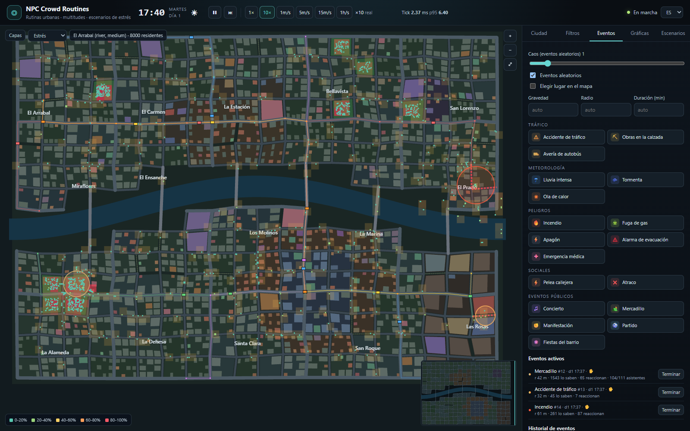

# Eventos

Hay 18 tipos de evento en 5 categorías (tráfico, meteorología, peligros, sociales y públicos), todos definidos en
`data/events.json`. Tabla completa: [Eventos (generado)](../referencia/generado/eventos.md).

## Cómo se generan

- **Aleatorios**: cada tipo es un proceso de Poisson. Su tasa es `tasa base/día × caos × multiplicador horario ×
  fin de semana` (los incidentes provocados por personas escalan además con la población). El nivel de **caos** (0–10)
  se cambia en vivo; con 0 no hay eventos aleatorios.
- **Manuales**: desde la interfaz o con la orden `inject_event`, en un lugar elegido o automático.
- **Programados**: en un escenario, a una hora concreta.
- **Emergentes**: una discusión entre rivales en la calle puede convertirse en una pelea callejera.

Cada parámetro dado como intervalo (radio, duración, gravedad) se sortea al crear el evento. El lugar depende del tipo:
una calle (accidente, obras), un edificio de ciertas categorías (incendio en viviendas, atraco en bancos o tiendas,
concierto en parques o plazas), un barrio (apagón, fiestas), cualquier punto con gente (pelea, emergencia médica) o
toda la ciudad (lluvia, tormenta, ola de calor; solo hay un fenómeno meteorológico a la vez).

## Ciclo de vida y efectos

Activo → recuperación → terminado. Mientras está activo, según el tipo:

- **corta calles**: los coches recalculan la ruta (las rutas en caché se invalidan); los peatones evitan las zonas de evacuación;
- **cierra edificios**: dejan de ser elegibles como destino;
- **cambia el tiempo** y la velocidad de peatones y coches, y penaliza las actividades al aire libre;
- **modifica necesidades** dentro del radio (estrés, miedo, aburrimiento...);
- **atrae público** (conciertos, mercadillos, partidos, fiestas);
- **retrasa autobuses** (avería).

## Percepción y propagación

Cada residente se entera por su cuenta:

1. **Lo ve o lo oye**: dentro de *radio × vista* si está en la calle, o de *radio × oído* aunque esté dentro de un edificio,
   con una probabilidad que crece con la curiosidad.
2. **Aviso público**: algunos eventos (incendio, fuga de gas, alarma, atraco...) emiten un aviso tras unos minutos que llega a
   todos los que están cerca.
3. **Boca a boca**: quien lo sabe se lo cuenta a sus contactos con una probabilidad por hora. Si el contacto está dentro de la
   zona, puede reaccionar (por ejemplo, evacuar); si no, solo se estresa un poco.

El inspector muestra *se entera de*, *se lo cuenta Fulano* y la reacción.

## Reacciones

Al enterarse, el residente elige entre ignorar, **observar**, **curiosear**, **ayudar**, **huir**, **evacuar** o
**refugiarse**. Los pesos base vienen del tipo de evento y se modulan por la personalidad (curiosidad, prudencia,
empatía, neuroticismo), la distancia, el miedo acumulado y su situación (dormido, conduciendo, en una obligación).
Mientras reacciona está en la actividad *Emergencia* con el subestado correspondiente; cuando el evento termina o pasa
su tiempo, vuelve a su vida normal y decide de nuevo.

En los conflictos (pelea, atraco), el más agresivo **persigue** y el otro **huye**.
