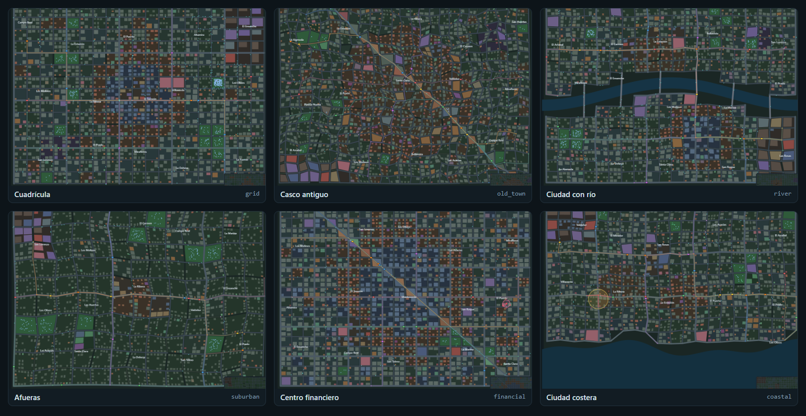

# Mapas

Una ciudad (`CityMap`) tiene: red de calles (intersecciones y tramos de tipo calle, avenida, peatonal, puente o paseo),
semáforos, nombres de calles, **barrios con nombre**, manzanas con su uso del suelo, edificios (polígonos con tipo,
plantas, viviendas, empleos y plazas escolares), agua (río o mar) y líneas de autobús con paradas.

## Generador por plantillas

`data/maps/templates.json` define 6 plantillas y 3 tamaños (tabla en
[Edificios y mapas (generado)](../referencia/generado/edificios-y-mapas.md)):

| Plantilla | Carácter |
|---|---|
| Cuadrícula | ensanche regular con avenidas, centro cívico y de negocios, campus e industria |
| Casco antiguo | calles irregulares y curvas, diagonal, muchas peatonales, centro histórico denso |
| Ciudad con río | río sinuoso con puentes, frente fluvial, casco antiguo en una orilla y negocios en la otra |
| Afueras | manzanas grandes, calles sin salida, casas unifamiliares, centro comercial |
| Centro financiero | retícula densa con torres de oficinas y residenciales, diagonal |
| Ciudad costera | litoral con paseo marítimo y frente marítimo |

*Las seis plantillas en tamaño mediano con la semilla 42, a las 10:00 del primer día.*

Pasos del generador (determinista por semilla):

1. Retícula de intersecciones con separación, *jitter* y deformación suave (*warp*); se eliminan las que caen en el agua.
2. Calles, avenidas cada N filas/columnas, diagonal opcional, puentes sobre el río y paseo marítimo.
3. Poda de tramos (se convierten en peatonales o desaparecen) **sin romper la conectividad para coches**.
4. Barrios: semillas de Voronoi con nombres de `data/maps/names.json`.
5. Uso del suelo de cada manzana mediante **reglas de zonificación** en orden (círculos, rectángulos, franja junto al
   agua, reparto por defecto con pesos y probabilidad).
6. Edificios: los tipos grandes (parques, centros comerciales, universidades...) ocupan la manzana entera; el resto
   se reparte en parcelas orientadas a la calle según los pesos y la densidad del tipo de barrio.
7. Servicios mínimos garantizados (hospital, colegios, supermercados, comisaría...) escalados con el tamaño.
8. Semáforos en cruces con avenidas, líneas de autobús por las avenidas con paradas cada ~260 m.

## Personalizar

- **Nuevas plantillas**: añade una entrada en `data/maps/templates.json` (sin tocar C++).
- **Nuevos tipos de edificio o barrio**: `data/buildings.json`.
- **Mapas propios**: archivos `npc-city-map` en `data/maps/custom/`; ver [Mapas personalizados](../datos/mapas-personalizados.md).
- **Partir de un mapa generado**: `npc_crowd_routines generate-map --template river --size medium --seed 7 --out mi_ciudad.json`
  (o *Exportar mapa actual* en la interfaz), edítalo y vuelve a cargarlo.
