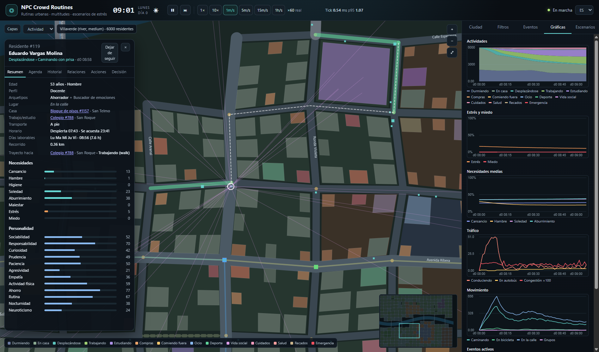
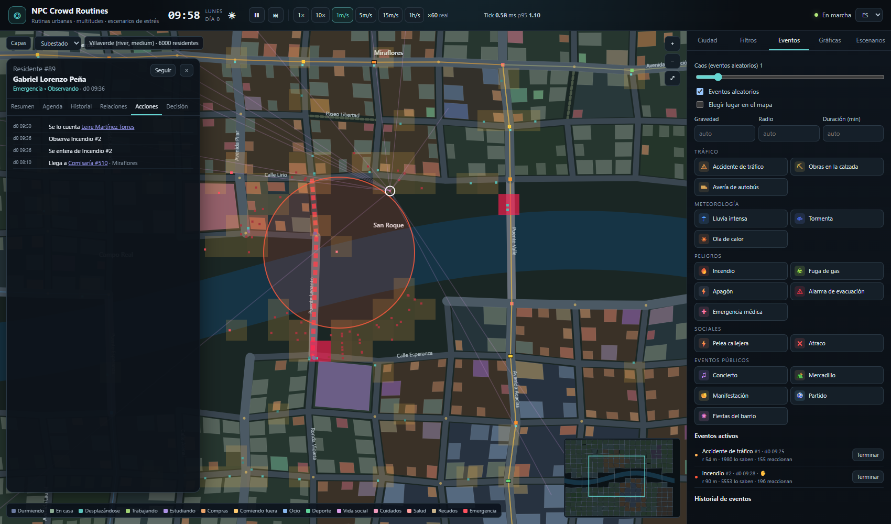

# Guía de la interfaz

La interfaz web es una ventana al motor C++: todo lo que ves (posiciones, estados, filtros, estadísticas)
lo calcula el motor; el navegador solo lo dibuja y envía tus órdenes.

## Cabecera

- **Reloj**: hora simulada, día de la semana, número de día y tiempo (☀ ☂ ⛈ ♨).
- **Reproducción**: pausa/reanudar (`Espacio`), avanzar un minuto, y velocidades: 1× (tiempo real), 10×,
  1 min/s, 5 min/s, 15 min/s y 1 h/s (teclas `1`–`6`). A la derecha, la velocidad *real* alcanzada.
- **Tick**: tiempo que tarda el motor en calcular un paso (p50 y p95, en milisegundos).
- **Idioma**: español / inglés, se cambia en caliente.

## Mapa

- **Zoom** con la rueda (centrado en el cursor) o con `+`/`−`; **mover** arrastrando; doble clic acerca.
- **Minimapa** abajo a la derecha: clic para saltar a esa zona.
- **Clic en un residente** abre el inspector; **clic en un edificio** muestra su ocupación, horario y quién está dentro.
- **Capas**: barrios, edificios, calles, tráfico en vivo (verde/amarillo/rojo, y calles cortadas en rojo discontinuo),
  densidad de gente en la calle, eventos, autobuses y paradas, residentes en interiores y nombres de barrios y calles.
- **Color por**: actividad, subestado, estrés, perfil, edad, género o transporte habitual. La leyenda se actualiza sola.

## Pestaña Ciudad: estado de la población

Indicadores generales (residentes, en la calle, desplazándose, grupos, emergencias, autobuses, estrés medio,
congestión y velocidades) y el **árbol desplegable de estados**: cada actividad muestra cuántos residentes hay y su
porcentaje, y se despliega en sus subestados. Las casillas de cada nivel **resaltan en el mapa** a esos residentes
(el resto se atenúa) y se combinan con los filtros.

## Pestaña Filtros

Constructor de condiciones evaluadas en C++: actividad, subestado, perfil, arquetipo, barrio, género, edad,
cualquier necesidad o rasgo (rango), transporte, lugar actual, lugar de trabajo, en la calle, en movimiento,
en grupo, en emergencia, tipo de relación, conoce algún evento, km recorridos o número de relaciones. Se combinan con
**Y** u **O**, cada condición se puede negar, y **Exportar CSV** descarga los residentes que coinciden.

## Pestaña Eventos

- **Caos**: multiplica la frecuencia de los eventos aleatorios (0 = ninguno). **Eventos aleatorios** los activa o desactiva.
- Botones por categoría para **provocar** cualquiera de los 18 eventos. Con **Elegir lugar en el mapa** activado, el
  siguiente clic en el mapa lo sitúa (se ve un círculo de previsualización). Gravedad, radio y duración son opcionales.
- **Eventos activos** con cuántos lo saben y cuántos reaccionan (y asistentes en eventos con público); clic para ir al lugar,
  **Terminar** para acabarlo. Debajo, el **historial**.

## Pestaña Gráficas

Series temporales (una muestra por minuto simulado): actividades apiladas, estrés y miedo, necesidades medias,
tráfico (conduciendo, en autobús, congestión), movimiento (caminando, en bici, en la calle, grupos) y eventos activos.
**Descargar CSV de telemetría** exporta todos los datos.

## Pestaña Escenarios

- **Nueva ciudad**: plantilla, tamaño, semilla, población, hora y día de inicio, o un mapa personalizado.
- **Escenarios**: cargar los de `data/scenarios/` o **guardar el actual** (configuración + eventos provocados).
- **Partidas guardadas**: guardar, cargar o **repetir y verificar** (vuelve a simular desde cero y comprueba el *checksum*).
- **Mapas personalizados**: subir un `.json` (se valida antes de guardarlo) o exportar el mapa actual para editarlo.

## Inspector de residentes

| Pestaña | Contenido |
|---|---|
| Resumen | Edad, perfil, arquetipos, lugar, casa, trabajo, transporte, horario, recorrido, trayecto actual, necesidades y personalidad |
| Agenda | Barra del día y lista de bloques: obligaciones (trabajo, clase, cuidados) y planes (deporte, compras, quedadas...) |
| Historial | Últimos 48 cambios de actividad y subestado, con hora y lugar |
| Relaciones | Familia, pareja, amistades, compañeros, vecinos y rivales con su vínculo y qué están haciendo ahora (clic para saltar) |
| Acciones | Registro: se despierta, llega a, charla con, se entera de un evento, se lo cuentan, huye, ayuda, sube al autobús... |
| Decisión | Puntuación de cada actividad en este momento y sus términos (necesidades, agenda, hora, desplazamiento, personalidad) |

**Seguir** (`F`) centra la cámara en el residente. `Esc` cierra.

## Enlaces compartibles

La dirección admite parámetros tras `#` para abrir la interfaz en un estado concreto, por ejemplo
`http://localhost:8080/#select=119&zoom=3&follow=1&tab=charts&layers=traffic`.
Parámetros: `select`, `itab` (pestaña del inspector), `building`, `tab`, `zoom`, `center=x,y`, `color`,
`layers` (lista), `follow`, `expand`, `lang`.
