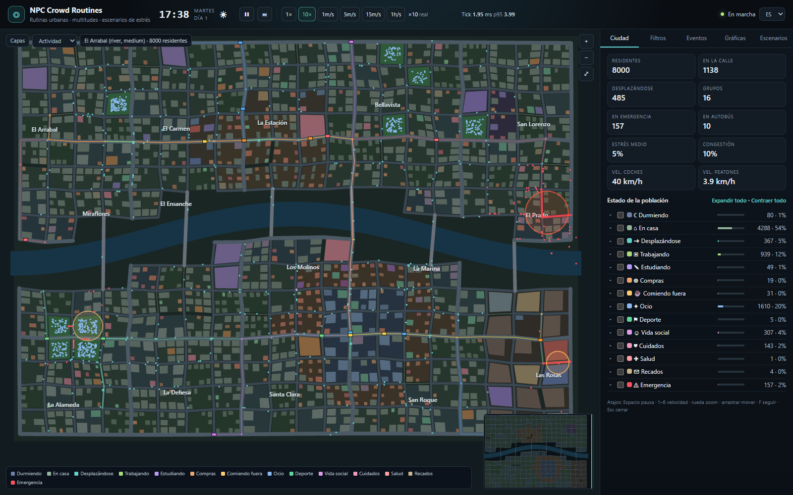

# NPC Crowd Routines

Simulador de una ciudad viva: miles de residentes con rutinas, personalidad y relaciones que trabajan,
estudian, compran, quedan con amigos, se desplazan a pie, en bici, en coche o en autobús, y reaccionan a
eventos (accidentes, incendios, tormentas, conciertos...). Sirve como banco de pruebas de comportamiento
emergente y de rendimiento con hasta 25.000 residentes o más.

*Ciudad con río (tamaño mediano, 8.000 residentes) un martes por la tarde: tráfico en vivo, un incendio, un accidente
y un mercadillo en curso.*

## Qué hay dentro

- **Un único motor de simulación en C++20**, determinista y de paso fijo. El navegador solo dibuja y envía órdenes.
- **14 actividades principales y 85 subestados** definidos en datos: cada residente está siempre en una actividad y un subestado concretos (*Desplazándose › Caminando y hablando*, *Trabajando › Pausa para el café*...).
- **IA por utilidad** con 8 necesidades, 12 rasgos, **48 arquetipos** combinables y **16 perfiles de rutina**, agendas diarias, grupos que caminan juntos y conversaciones o discusiones en la calle.
- **Mapas procedimentales** con 6 plantillas (cuadrícula, casco antiguo, río, afueras, centro financiero, costa) en 3 tamaños, barrios con nombre, 36 tipos de edificio con horarios, líneas de autobús y semáforos; además, **mapas personalizados** en JSON.
- **18 tipos de evento** con generación aleatoria (nivel de caos), percepción, avisos públicos, boca a boca y reacciones según la personalidad.
- **Escenarios reproducibles**: semilla, eventos programados, partidas guardadas con verificación por *checksum*.
- **Interfaz web** en español e inglés: zoom, capas, árbol de estados desplegable, filtros combinados, inspector con agenda/historial/relaciones/acciones/decisión y gráficas en el tiempo.

## Por dónde empezar

| Quiero... | Página |
|---|---|
| Compilar y abrir la simulación | [Primeros pasos](primeros-pasos.md) |
| Aprender a usar la interfaz | [Guía de la interfaz](guia/interfaz.md) |
| Entender cómo deciden los residentes | [Comportamiento](conceptos/comportamiento.md) |
| Crear mis propios mapas, actividades o eventos | [Datos y personalización](datos/index.md) |
| Repetir experimentos | [Escenarios y reproducibilidad](conceptos/reproducibilidad.md) |
| Ver el rendimiento | [Rendimiento](rendimiento/index.md) |
| Conocer el alcance y los límites del modelo | [Consideraciones y limitaciones](consideraciones.md) |
| Resolver dudas habituales | [Preguntas frecuentes](faq.md) · [Glosario](glosario.md) |
| Contribuir | [Control de versiones](desarrollo/control-de-versiones.md) |

Esta documentación vive en `docs/` del repositorio y se publica automáticamente como web con GitHub Pages
(ver [Pruebas e integración continua](desarrollo/pruebas.md)). Las tablas de referencia se **generan a partir de
los archivos de datos**, así que siempre coinciden con lo que ejecuta el motor.
